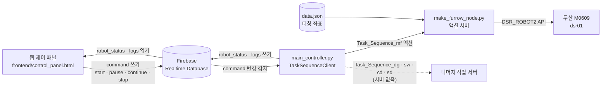
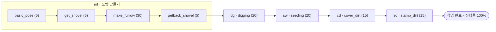
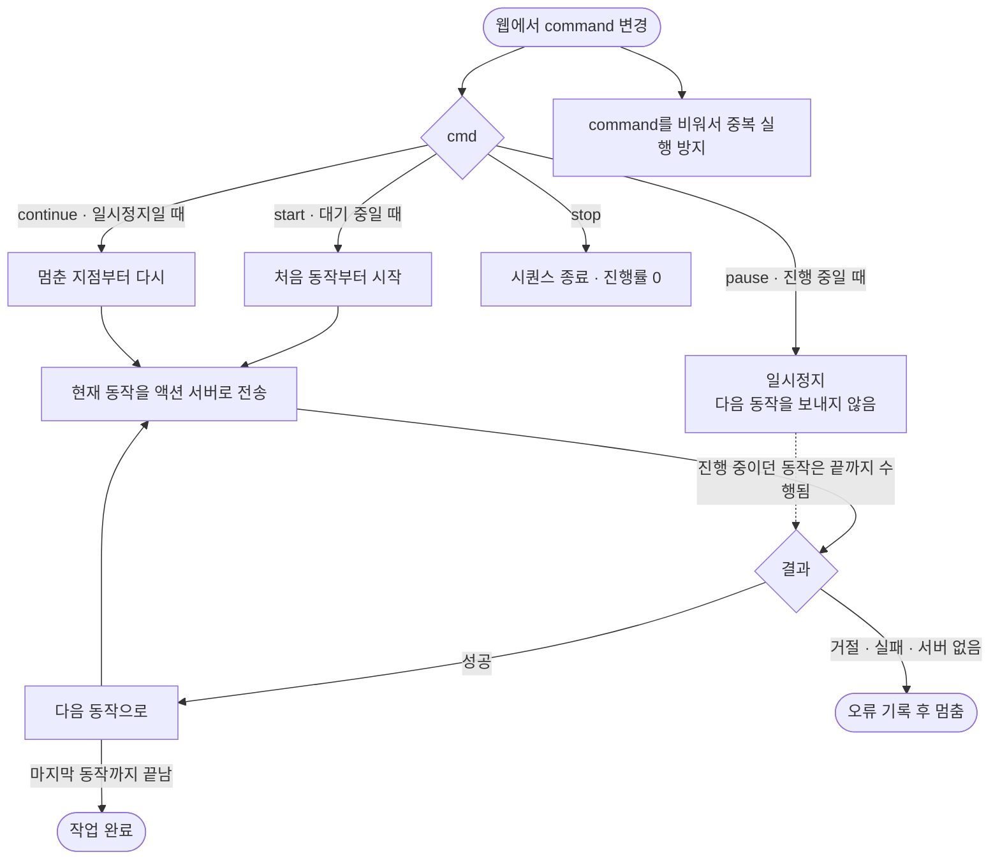

# 영남향우회 자동파종기기

## Doosan Robotics Rokey Boot Camp 6기 협동1 A-2조 프로젝트 복원자료입니다.

이 프로젝트는 Firebase Realtime Database를 활용하여 웹 기반의 인터페이스로 M0609의 파종작업을 원격으로 제어하는 시스템입니다.

## 프로젝트 개요
- 기술 스택: ROS2 (Humble), Python, Firebase Admin SDK, HTML/JS
- 주요 기능:
  1. 웹 패널을 통한 실시간 로봇 상태 모니터링 및 제어 (시작/일시정지/중지)
  2. Firebase를 매개체로 한 클라우드-로봇 통신
  3. 액션 서버(Action Server) 기반의 정밀한 시퀀스 제어

> **복원 상태**: 이 저장소에는 작업 5단계 중 **1단계(도랑 만들기, `mf`)의 액션 서버만** 들어 있습니다.
> 땅 파기(`dg`)·파종(`sw`)·흙 덮기(`cd`)·흙 다지기(`sd`) 서버는 없어서, 지금 그대로 실행하면 도랑 만들기가 끝난 뒤
> `Action server not available: dg` 로 멈춥니다.

## 동작 흐름

### 구성



### 작업 순서

시작하면 아래 순서대로 한 동작씩 액션 서버에 보내고, 끝나면 다음 동작을 보냅니다. 괄호 안 숫자는 진행률 가중치(합계 115)입니다.



### 명령 처리 (`main_controller.py`)



> **⚠️ 일시정지·중지는 로봇을 즉시 멈추지 않습니다.** 액션 서버가 취소 요청을 받지 않기 때문에, 진행 중인 동작(예: 삽 집기)은
> 끝까지 수행되고 **그다음 동작부터** 보내지 않습니다. 위험할 때는 반드시 티치펜던트나 외부 **비상정지 버튼**을 누르세요.

##  폴더 구조

```
Youngnam_Robot_Control/
├── .gitignore               # Firebase 키, build, install 등
├── README.md                # 프로젝트 설명 및 실행 순서 기록
│
├── frontend/                # [웹 제어 패널]
│   └── control_panel.html
│
├── src/                     # [ROS2 소스 코드]
│   ├── main_controller.py   # 전체 흐름 제어 (Firebase 명령 → 액션 순서 제어)
│   └── make_furrow_node.py  # 실제 로봇 동작 수행 (도랑 만들기 액션 서버)
│
└── config/                  # [설정 파일] 저장소에 없음, 직접 만들어 넣음
    ├── data.json            # 로봇의 위치(Pose) 데이터
    └── firebase_key.json    # Firebase Admin SDK 비밀키 (절대 올리지 말 것)
```

`.gitignore`가 모든 `*.json`을 제외하므로 `firebase_key.json`은 올라가지 않습니다. `data.json`은 비밀이 아니라서 예외로 올릴 수 있습니다.

### `data.json` 형식

```json
{
  "home":    [x, y, z, rx, ry, rz],
  "tool":    [x, y, z, rx, ry, rz],
  "startgo": [x, y, z, rx, ry, rz]
}
```
- `tool`: 삽 보관 위치, `startgo`: 도랑 파기 시작 지면 위치 (mm, deg). 접근 높이는 코드에서 Z=650mm로 정합니다.
- `make_furrow_node.py`는 다음 순서로 찾습니다: 환경변수 `POSE_FILE` → 스크립트와 같은 폴더의 `data.json` → 저장소의 `config/data.json`.

## 실행 방법

### 1. 사전 준비
- ROS2가 설치된 환경에서 `cobot1_interfaces` 액션 패키지가 빌드되어 있어야 합니다.
- 두산 ROS2 패키지(`DSR_ROBOT2`, `DR_init`)가 source 되어 있어야 합니다.
- Firebase 콘솔에서 생성한 서비스 계정 키(.json)를 `config/firebase_key.json`에 둡니다(다른 위치면 환경변수 `FIREBASE_KEY`로 지정).
- Firebase Realtime Database 주소를 환경변수 `FIREBASE_DB_URL`로 지정합니다.
- `pip install firebase-admin`

### 2. 로봇 동작 서버 실행

```bash
# Terminal 1
ros2 run <package_name> make_furrow_node
```

### 3. 메인 컨트롤러 실행(Firebase 리스너)

```bash
# Terminal 2
export FIREBASE_DB_URL="https://<프로젝트>-default-rtdb.<지역>.firebasedatabase.app/"
python3 src/main_controller.py
```

### 4. 웹 패널 접속
- `frontend/control_panel.html` 파일을 브라우저로 열어 로봇을 제어합니다.
- 패널 아래에 로봇 상태(`robot_status`)와 진행률이 실시간으로 표시됩니다.
- 패널은 로그인 없이 DB에 씁니다. **Realtime Database 규칙이 누구나 쓸 수 있게 열려 있으면, 주소를 아는 누구나 로봇에 명령을 보낼 수 있습니다.** 실습 기간에만 열어 두고, 끝나면 규칙을 잠그세요.
